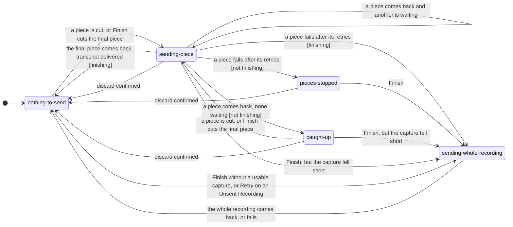

# Introduction

This specification defines the implemented microphone
`RecordingStateMachine` and its composition with authentication readiness,
Unsent Recording recovery, the background sending of Recording Pieces, and the
separate `SelectedAudioController`.

The recording FSM remains microphone-only. Selected Audio is not represented by
new recording states. The two owners share one `AzureAPIClient`, one transcript
completion path, and one Audio Source safety boundary.

## 1. Purpose and scope

The recording FSM makes microphone lifecycle transitions predictable and gives
the UI one source of truth for recording controls. `AudioHandler` coordinates
the browser recording APIs, authentication readiness, Azure submission, and
recovery around that FSM.

`SelectedAudioController` owns one local file independently. Application
bootstrap composes both owners so a User cannot activate microphone capture and
Selected Audio at the same time.

This specification covers:

- the exact nine microphone recording states and transition matrix;
- event and control-render ownership;
- authentication and Target URI readiness before recording activation;
- memory-only Unsent Recording retention and navigation safety;
- Recording Pieces: the capture beside the recorder, the background sending
  state owner that runs beside the FSM, the Partial Transcript, and the
  whole-recording fallback;
- the separate Selected Audio lifecycle and explicit Transcribe boundary;
- success, authentication, authorization, and retry convergence.

It does not define MSAL internals, model request shapes, Azure RBAC mutation, or
transcript storage implementation.

## 2. Domain definitions

- **Audio Source**: microphone capture or selected local audio supplied by the
  User for transcription.
- **Unsent Recording**: valuable captured audio not yet accepted for
  transcription. It remains memory-only in `AudioHandler` until success or an
  explicit discard.
- **Selected Audio**: a local Audio Source held in memory for review and not yet
  sent to Azure.
- **Authentication readiness**: a safe state returned by
  `AuthenticationService.ensureTokenReady(scope)` before microphone access or a
  Selected Audio submission.
- **Navigation safety**: token-free state used to block redirect/logout while an
  Audio Source could be lost.
- **Recording Piece**: a slice of a microphone recording sent for transcription
  while recording continues.
- **Partial Transcript**: the text of the Recording Pieces transcribed so far,
  shown while a recording is still in progress or finishing.
- **Whole recording**: the MediaRecorder Blob of the same recording. It is the
  fallback, the Retry payload, the Download payload, and, once Finish has
  started, the Unsent Recording.

## 3. Component ownership

| Concern | Owner |
|---|---|
| Microphone lifecycle state and legal transitions | `RecordingStateMachine` |
| MediaRecorder, stream, chunks, Unsent Recording, retry Blob | `AudioHandler` |
| Uncompressed 16 kHz capture and the cutting of Recording Pieces | `preparePcmCapture()` in `js/pcm-capture.js`, with its processor in the same-origin `js/pcm-capture.worklet.js`; prepared, started, paused, finished, and released by `AudioHandler` |
| The Recording Pieces of the current recording, their order, the single upload in flight, the Partial Transcript, and the background sending state | `RecordingPieceSender` in `js/recording-piece-sender.js`, constructed by `AudioHandler` |
| Rebuilding one transcript from the timed words of the pieces | `joinRecordingPieces()` in `js/recording-piece-joiner.js` |
| Placing the Partial Transcript in the transcript box, and keeping it out of Grab and saves | `UI` via `UI_PARTIAL_TRANSCRIPT_CHANGED` |
| One memory-only local File and its validation/transcription state | `SelectedAudioController` |
| Authentication state and token readiness | `AuthenticationService` |
| Redirect/logout recovery choices | `AuthInteractionController` |
| One-Audio-Source coordination | `SelectedAudioController.getAudioSafetyState()` composed with `AudioHandler.setAudioSourceCoordinator()` |
| Recording/Selected Audio presentation and completion | `UI` via event bus |
| Azure request, bearer header, errors, bounded retries, for pieces and whole recordings alike | shared `AzureAPIClient` |
| Transcript persistence | `TranscriptStore` after `UI_TRANSCRIPTION_READY` |

The FSM MUST NOT own a File, Blob, token, Target URI, User identity, DOM node, or
Azure request. Selected Audio MUST NOT transition the recording FSM.
`RecordingPieceSender` MUST NOT see a token or build a header, and MUST NOT
transition the recording FSM.

## 4. Readiness and Audio Source activation

The UI starts in authentication checking. While authentication is not ready,
the idle recording action and Upload audio action are unavailable. A signed-out
or interaction-required User sees explicit **Continue with Microsoft** instead.

Every microphone start still validates prerequisites defensively, even when the
UI is already ready:

```text
User chooses Start recording
  -> reject when Selected Audio exists
  -> protect authentication-failed Unsent Recording
  -> transition IDLE/ERROR -> INITIALIZING
  -> verify browser recording support
  -> require manual Target URI and validate HTTPS
  -> ensure token readiness for the selected adapter scope
  -> request microphone permission
  -> start MediaRecorder
  -> transition INITIALIZING -> RECORDING
```

Authentication readiness therefore occurs before microphone permission and
before active `RECORDING`, although the FSM enters `INITIALIZING` to render the
in-progress prerequisite check. A failure returns to `IDLE` without recording.

Selected Audio selection requires authentication `READY`, no current File, and
`AudioHandler` safety state `SAFE`. A Selected Audio Transcribe action checks
readiness again for the snapshotted model before calling Azure.

## 5. RecordingStateMachine contract

### 5.1 Exact states

| State | Meaning | Handler-owned emissions |
|---|---|---|
| `IDLE` | Ready for a new microphone attempt | default `UI_STATUS_UPDATE` |
| `INITIALIZING` | Checking prerequisites and starting MediaRecorder | initializing status |
| `RECORDING` | Microphone capture active | `RECORDING_STARTED`, recording status |
| `PAUSED` | Capture paused | `RECORDING_PAUSED`, paused status |
| `STOPPING` | Recorder stop/data flush in progress | `RECORDING_STOPPED`, finishing status, `VISUALIZATION_STOP` |
| `PROCESSING` | Captured Blob is being transcribed | processing status |
| `CANCELLING` | Capture is being discarded and cleaned | `RECORDING_CANCELLED`, cancelled status |
| `CONFIRMING_DISCARD` | Substantial active recording awaits Keep/Discard | `DISCARD_CONFIRM_REQUESTED` with duration label |
| `ERROR` | Capture or transcription failed | `RECORDING_ERROR`, error status |

There are exactly nine states. `CONFIRMING_DISCARD` leaves the recorder running
under the dialog until Keep or Discard is selected.

### 5.2 Exact transition matrix

```javascript
const STATE_TRANSITIONS = {
    idle: ['initializing', 'error'],
    initializing: ['recording', 'error', 'idle'],
    recording: ['paused', 'stopping', 'cancelling', 'confirmingDiscard'],
    paused: ['recording', 'stopping', 'cancelling', 'confirmingDiscard'],
    stopping: ['processing', 'error'],
    processing: ['idle', 'error'],
    cancelling: ['idle'],
    confirmingDiscard: ['recording', 'paused', 'cancelling'],
    error: ['idle', 'processing']
};
```

`transitionTo(newState, data)` validates first. An invalid transition logs
through the centralized error handler, returns `false`, and leaves state
unchanged. A valid transition stores `previousState`, updates current state,
emits `RECORDING_STATE_CHANGED`, and then awaits the target handler. If a
handler throws, the new state has already committed and the caller owns
recovery.

### 5.3 Interface

```javascript
class RecordingStateMachine {
    constructor(audioHandler)
    getState(): string
    canTransitionTo(newState): boolean
    transitionTo(newState, data?): Promise<boolean>
    isIdle(): boolean
    isRecording(): boolean
    isPaused(): boolean
    isProcessing(): boolean
    canRecord(): boolean
    canPause(): boolean
    canResume(): boolean
    canInvokeStop(): boolean
    canCancel(): boolean
}
```

`canRecord()` is true in `IDLE` or `ERROR`. `canInvokeStop()` is true in
`RECORDING`, `PAUSED`, `STOPPING`, or `CANCELLING`. Those are FSM capabilities,
not complete application readiness; authentication, configuration, and
Audio Source coordination are checked by the surrounding owners.

## 6. Event and presentation ownership

Every successful transition first emits:

```javascript
{
    newState: '<RECORDING_STATES value>',
    oldState: '<previous value>',
    ...safeTransitionData
}
```

`RECORDING_STATE_CHANGED` is the sole recording-control render input for labels,
enabled state, visible actions, and processing indicator. FSM handlers emit
only their documented domain/status/visualization/discard events. They MUST NOT
emit or manipulate granular button/spinner/reset presentation.

No recording event may contain captured chunks, piece audio, a word list, an
Unsent Recording Blob, Selected Audio File, token, Target URI, authentication
response, or transcript body. `UI_TRANSCRIPTION_READY` and
`UI_PARTIAL_TRANSCRIPT_CHANGED` are the deliberate transcript-content events,
each carrying only `{ text }`, and neither is part of the FSM state payload.

## 7. Unsent Recording lifecycle and navigation safety

When MediaRecorder stops normally, `AudioHandler` constructs the captured Blob
and assigns it to `pendingRetryBlob` before calling Azure. That Blob is the
Unsent Recording. It remains in application memory during `PROCESSING` and after
a failed submission.

For a model that declares `MODEL_CAPABILITIES.RECORDING_PIECES`, most of the
recording is transcribed in Recording Pieces before `PROCESSING` begins; §8
defines that path. The MediaRecorder Blob described here is still built, assigned
to `pendingRetryBlob` before anything is sent at Finish, and kept until a
transcript is delivered, so every rule in this section applies to it unchanged.

On success, `AudioHandler` clears the Blob, clears recovery metadata, empties
chunks, and transitions `PROCESSING -> IDLE`.

On failure, `AudioHandler` retains the same Blob and transitions
`PROCESSING -> ERROR` with a safe message and retry capability:

- ordinary retryable application/service failures may use the explicit Retry
  action (`ERROR -> PROCESSING`);
- upload-limit failures are not retryable without a new Audio Source;
- HTTP 401 and 403 require external recovery rather than blind retry.

`getAudioSafetyState()` exposes only:

- `UNSENT` whenever `pendingRetryBlob` exists, including while that Blob is in
  its initial `PROCESSING` attempt or an explicit retry;
- otherwise, `ACTIVE` while microphone initialization, capture, stop,
  processing, or cancellation is active; or
- `SAFE` otherwise.

`AuthInteractionController` uses that token-free state before full-page sign-in
or logout:

- `ACTIVE` blocks navigation;
- `SELECTED` blocks navigation until Selected Audio is removed;
- `UNSENT` offers a local download while retaining the Blob, followed by an
  explicit Continue, or an explicit proportional discard followed by redirect;
- `SAFE` permits the requested redirect.

Downloading marks only that the browser download lifecycle was initiated; it
does not discard the Blob or navigate. No navigation-safety path automatically
redirects, uploads, logs out, or discards an Audio Source.

## 8. Recording Pieces and background sending

### 8.1 Which recordings get pieces

A microphone recording is transcribed in Recording Pieces when the model selected
at the start of the recording declares `MODEL_CAPABILITIES.RECORDING_PIECES`.
Only MAI-Transcribe 2 declares it. Whisper, GPT Transcribe, MAI-Transcribe 1.5,
and Selected Audio keep the whole-file path. There is no setting.

### 8.2 Capture and cutting

`AudioHandler` constructs one capture with `preparePcmCapture()` when the page
loads. Its AudioContext runs at `RECORDING_PIECE_SAMPLE_RATE` (16 kHz), so the
browser resamples the microphone, and its worklet node downmixes to one channel.
The context and worklet are prepared then and wait suspended. Starting a
recording only connects the stream and resumes the context, before
MediaRecorder starts, so no speech is missing from the capture. If the browser
cannot prepare the capture, or the context is not running after the resume, the
recording keeps the whole-file path and the User is shown nothing.

MediaRecorder keeps running unchanged beside the capture and produces the whole
recording.

The worklet processor is a same-origin file that the build emits under
`assets/`, loaded with `new URL('./pcm-capture.worklet.js', import.meta.url)`,
never a `blob:` or `data:` URL, so a `script-src 'self'` policy allows it.
`vite.config.js` keeps `.worklet.js` files from being inlined. The capture code
counts towards the application size budget, which is 26 kB in the
`size-limit` entry of `package.json`.

A cut is made every `RECORDING_PIECE_TUNABLES.PIECE_MS` (60 seconds) of captured
audio. Neighbouring pieces share `RECORDING_PIECE_TUNABLES.OVERLAP_MS`
(1.5 seconds) of audio with the cut point in the middle, so a piece is cut once
the audio has run half the overlap past its cut. There is no silence or voice
detection. Pause and resume pause and resume the capture, so paused time is
neither captured nor counted towards the next cut. Each piece is encoded with
`encodeWav()` as 16 kHz mono 16-bit WAV; the whole-file converter is never used
for a piece. Captured samples stay in memory only until the piece holding them
has been cut.

Finish cuts the final piece at once, whatever its length. The capture rejects
the final piece, and the whole recording is sent instead, when the capture is
shorter than the recorded time by more than
`RECORDING_PIECE_SHORTFALL_TOLERANCE_MS` (500 ms), including an empty capture.
The check runs only at Finish, so earlier pieces may already have been sent;
sending the whole recording aborts any piece still in flight and drops the
pieces' words, and only the whole recording's result is shown.

The deterministic browser build shortens the tunables to 3 seconds and
0.4 seconds through its compile-time authentication double, so a test recording
passes a cut within seconds. Production builds use the values above.

### 8.3 Sending, joining, and showing text

`RecordingPieceSender` owns the pieces of the current recording. It sends one
piece at a time, in the order they were cut, through
`AzureAPIClient.transcribePiece(wavBlob, signal)`, which acquires a token per
request, builds the bearer header, applies the bounded retry, and returns the
piece's timed words. The sender never sees a token and never builds a header. A
piece counts as failed only after the client has given up.

After each piece comes back, the sender joins the words of every piece so far
with `joinRecordingPieces()`: at each cut a word is kept from the earlier piece
when its midpoint falls before the cut, and from the later piece otherwise, and
the kept words are joined with single spaces. Word text is never compared between
pieces and is kept exactly as the model wrote it. The joined text is emitted as
the Partial Transcript through `UI_PARTIAL_TRANSCRIPT_CHANGED`.

`UI` places the Partial Transcript where a finished transcript would be placed:
at the end of the box, after a divider only when finished text comes before it,
replacing the Partial Transcript shown before. When the User is editing the box,
the caret and scroll position stay where they were. The Partial Transcript is
never saved: Grab copies and clears only the finished text and leaves the Partial
Transcript in the box, and a Grab when the box holds only the Partial Transcript
changes nothing and reports `MESSAGES.NOTHING_TO_GRAB_YET`. A save while the box
holds only the Partial Transcript, including the debounced save after typing,
saves nothing and leaves the stored transcript untouched. These guards recognise
the Partial Transcript only while it is unchanged at the end of the box: once the
User edits it, it is the User's text and is saved and grabbed like any other,
and a box the User empties completely clears the stored transcript as it does
today. Restore is offered
only while the box is empty, so it is hidden while a Partial Transcript shows,
and it brings back only the saved finished transcript. Grab, Restore, and the
saved transcript deal only with finished transcripts.

`UI_TRANSCRIPTION_READY` fires once, when every piece is in, carrying the joined
transcript; the UI then removes the Partial Transcript and places the finished
transcript, and autosave happens only then. If the User has edited the Partial
Transcript, the box is left as it is and the finished transcript is placed after
it, so no typed word is lost.

### 8.4 Background sending states

Background sending runs beside the recorder. The recorder keeps its nine states
and its exact transition table (§5); the sender holds its own
`BACKGROUND_SENDING_STATES`:

| State | Meaning |
|---|---|
| `nothing-to-send` | No piece is waiting or in flight |
| `sending-piece` | One piece is in flight, possibly with others waiting behind it |
| `caught-up` | Every piece cut so far is transcribed |
| `pieces-stopped` | A piece failed while recording; no more pieces are cut or sent |
| `sending-whole-recording` | The whole recording is being sent through the whole-file path |

The implemented transitions, with the recorder states they happen in:



Sending the whole recording first aborts any piece still in flight and drops
every piece. Every microphone recording that is not finished in pieces, including
one for a model without the capability, goes through `sending-whole-recording`.

### 8.5 Failure and fallback

Nothing on this path depends on the User noticing a message while recording.
Every failure during recording is silent and ends in the whole recording being
sent.

- **A piece fails while recording or paused** (or while the discard dialog is
  open): the sender enters `pieces-stopped`, `AudioHandler` releases the capture,
  recording continues, and the User is shown nothing. The Partial Transcript
  shown so far stays in the box. At Finish the whole recording is sent through
  `transcribe()`, conversion included, and its result replaces the Partial
  Transcript.
- **A piece fails at Finish**, the final piece or one still outstanding: the
  whole recording is sent automatically, as above. If it comes back, the
  transcript is delivered. If it also fails, the recording becomes an Unsent
  Recording under §7.
- **The whole recording fails**: an Unsent Recording under §7, with its error
  category, Retry, Download, and discard unchanged. Retry always sends the whole
  recording. The Partial Transcript stays shown until Retry's result replaces
  it, the Unsent Recording is discarded, or a new recording starts.
- **Authentication and authorization**: a 401 or 403 on a piece is a failed piece
  like any other. It emits no `API_REQUEST_ERROR` and reaches authentication
  recovery only through the whole recording at Finish.
- **Configuration**: a piece reads the configuration without opening Settings.
  A Target URI cleared mid-recording, or a switch to a model without the
  capability, fails the piece; the whole recording then goes to the model
  selected at Finish.

### 8.6 Discard

Confirming a discard first releases the capture, so audio still arriving cannot
cut a new piece, then aborts the upload in flight with its retries and backoff,
drops every piece, and removes the Partial Transcript, and then tears the
recorder down as before, releasing the whole recording. Proportional discard is
unchanged; while a Partial Transcript is shown, the dialog says that the
recording and the text shown so far will be removed
(`MESSAGES.DISCARD_RECORDING_AND_TEXT`). Discarding an Unsent Recording, and
starting a new recording over one, also discard the sender.

### 8.7 Status text and navigation

A recording finished in pieces shows the recorder's finishing and processing
statuses, then `MESSAGES.FINISHING_TRANSCRIPT` while the final piece and any
outstanding piece are sent, and no conversion status. A piece sends no progress
status. The whole-recording fallback shows today's conversion and sending
statuses.

Pieces are sent only while the recorder is `RECORDING`, `PAUSED`,
`CONFIRMING_DISCARD`, `STOPPING`, or `PROCESSING`, all of which already make
`getAudioSafetyState()` return `ACTIVE` or `UNSENT`. `AuthInteractionController`
remains the only navigation-safety coordinator, and navigation safety never
redirects, logs out, uploads, or discards automatically. The only automatic
uploads are the Recording Pieces themselves and the whole-recording fallback in
§8.5.

### 8.8 Rules that must always hold

1. When the app is ready for a new recording, nothing is being sent.
2. Until the transcript is complete or the User discards, the whole recording is
   kept.
3. A transcript is called complete only when every Recording Piece is in it.
4. Sign-out never leaves a recording, an upload, or an unsent copy behind.
5. Background sending never reports that it is caught up while a piece is
   outstanding.

Each rule has a test of its own in `tests/recording-piece-send.vitest.js`.

### 8.9 Privacy

Piece audio and word lists never enter storage, logs, error details, or event
payloads and history. The Partial Transcript is transcript content under the same
rules as a finished transcript, except that it is never saved.

## 9. Selected Audio contract

`SelectedAudioController` privately owns one `File` and exposes only a frozen,
safe display snapshot. The exact states are:

| State | Entry/meaning | Allowed User recovery |
|---|---|---|
| `IDLE` | no File | Select an Audio Source |
| `CHECKING` | local format/size/duration validation | wait |
| `READY` | accepted for snapshotted model; nothing sent | Transcribe, Remove, or Replace through chooser |
| `UNSUPPORTED` | format or decode cannot be accepted | Choose another or Remove |
| `TOO_LARGE` | model upload limit exceeded | Choose another or Remove |
| `TRANSCRIBING` | explicit request active | wait; navigation remains unsafe |
| `FAILED` | same File retained with safe error | Retry or Remove |

Selection is memory-only. Snapshots/events may contain name, size, optional
duration, format, model, state, and safe error metadata, but never the File,
bytes, object URL, token, or Target URI. Temporary metadata object URLs are
revoked on every outcome.

A model change revalidates the current File unless it is already transcribing.
Before submission the controller checks that the current model still matches
the validated snapshot and ensures authentication readiness for that model's
scope. This prevents stale/ABA model submission.

## 10. One API client and success convergence

Both Audio Sources call the same injected `AzureAPIClient`:

```text
microphone pieces: RECORDING/PAUSED -> RecordingPieceSender -> AzureAPIClient.transcribePiece ─┐
                                        (Partial Transcript, never saved)                    │
microphone: STOPPING -> PROCESSING -> joined pieces, or AzureAPIClient.transcribe ────────────┤
                                                                                              ├─ UI_TRANSCRIPTION_READY
Selected Audio: READY -> TRANSCRIBING -> AzureAPIClient.transcribe ──────────────────────────┘
                                                                                              │
                                                                     UI append + TranscriptStore autosave
```

On Selected Audio success, the controller emits `UI_TRANSCRIPTION_READY`, emits
the temporary completion status, removes the File, and returns to `IDLE`.
On microphone success, whether the transcript was joined from pieces or came
back for the whole recording, `AudioHandler` emits the same transcription-ready
and completion events, clears the Unsent Recording, and transitions to recording
`IDLE`.

The convergence guarantees identical append/divider/autosave behavior without
putting file states into the recording FSM.

## 11. Authentication and authorization recovery

- **Not ready before capture/submit**: emit safe
  `AUTHENTICATION_STATE_CHANGED`, keep network/microphone action gated, and
  present explicit Continue with Microsoft when appropriate.
- **HTTP 401**: retain the Audio Source. For microphone capture, present
  download/discard authentication recovery; for Selected Audio, retain the File
  in `FAILED` for explicit recovery. Never retry or redirect automatically.
- **HTTP 403**: retain the Audio Source and present Azure setup/RBAC guidance.
  The app never assigns a role or broadens authorization.
- **HTTP 429/selected 5xx/timeouts**: use only the bounded API-client behavior;
  then retain the Audio Source for explicit retry when the boundary is
  exhausted.
- **Recording Pieces**: a 401, 403, or exhausted retry on a piece is a failed
  piece (§8.5). The recovery above applies only to the whole recording sent at
  Finish or on Retry.

## 12. Acceptance criteria

- **AC-001**: The FSM implements exactly the nine documented states and exact
  transition matrix.
- **AC-002**: Invalid transitions return false without changing state.
- **AC-003**: Every valid transition emits `RECORDING_STATE_CHANGED` before the
  target handler's documented events.
- **AC-004**: Recording controls render only from recording state changes; no
  handler directly manipulates DOM or emits granular control commands.
- **AC-005**: Signed-out, interaction-required, configuration-failed, or
  authentication-failed state prevents microphone and Upload audio activation.
- **AC-006**: A start attempt verifies HTTPS configuration and token readiness
  before microphone permission and before entering `RECORDING`.
- **AC-007**: A failed microphone submission retains one memory-only Unsent
  Recording until success or explicit discard.
- **AC-008**: Authentication redirect and logout cannot lose active, Unsent, or
  Selected Audio; download alone does not navigate.
- **AC-009**: Selected Audio uses the separate seven-state controller and never
  adds a recording FSM state.
- **AC-010**: Only one Audio Source can be active.
- **AC-011**: Selected Audio sends nothing before explicit Transcribe and
  retains the same File for explicit Retry after ordinary failure.
- **AC-012**: Both sources use the one API client and converge through
  `UI_TRANSCRIPTION_READY` to transcript append/autosave.
- **AC-013**: HTTP 401 and 403 cause distinct, non-retrying recovery while
  retaining valuable audio.
- **AC-014**: No state, snapshot, event, log, or storage record contains audio
  bytes, a File/Blob, a piece word list, bearer token, authentication response,
  or Target URI.
- **AC-015**: Only a model declaring `MODEL_CAPABILITIES.RECORDING_PIECES` gets
  Recording Pieces, cut every `RECORDING_PIECE_TUNABLES.PIECE_MS` of recorded
  audio with `OVERLAP_MS` shared around each cut, and sent one at a time, in
  order, through `AzureAPIClient`.
- **AC-016**: The Partial Transcript is shown after each piece comes back, is
  never saved or grabbed, and `UI_TRANSCRIPTION_READY` fires once, when every
  piece is in.
- **AC-017**: A failed piece is silent and leads to the whole recording being
  sent at Finish; a failed whole recording becomes an Unsent Recording, and
  Retry sends the whole recording.
- **AC-018**: Confirming a discard aborts the upload in flight, drops every piece
  and the Partial Transcript, and releases the whole recording.
- **AC-019**: The five rules in §8.8 hold.

## 13. Verification

Primary deterministic coverage includes:

- `tests/recording-state-machine.vitest.js` — exact transitions, handler order,
  query methods, and single control-render event;
- `tests/recording-integration.vitest.js` and
  `tests/audio-handler-integration.vitest.js` — MediaRecorder lifecycle,
  readiness, processing, and completion;
- `tests/auth-recovery.vitest.js` and `tests/discard-flow.vitest.js` — Unsent
  Recording download/discard/navigation safety;
- `tests/audio-source-coordination.vitest.js` — one active Audio Source;
- `tests/pcm-capture.vitest.js` — preparing, starting, pausing, cutting, and
  finishing the uncompressed capture, and the shortfall check;
- `tests/recording-piece-joiner.vitest.js` — the joiner's midpoint rule;
- `tests/recording-piece-sender.vitest.js` — late words after a discard, and
  Finish after pieces have stopped;
- `tests/recording-piece-send.vitest.js` — Recording Pieces driven through
  `AudioHandler`: order, the Partial Transcript, readiness, failure and fallback,
  discard, pause, sign-out safety, privacy, and one test for each rule in §8.8;
- `tests/transcript-autosave.vitest.js` — Grab and saves leaving the Partial
  Transcript out, and the stored transcript kept;
- `tests/token-boundary.vitest.js` — the sender never sees a token;
- `tests/browser/recording-pieces.spec.js` — built-browser capture from the fake
  microphone: one piece with no conversion status, a recording past a cut with
  the joined transcript arriving while recording, and a failed piece followed by
  the whole-recording fallback;
- `tests/selected-audio.vitest.js` and `tests/selected-audio-ui.vitest.js` —
  memory-only File state, model revalidation, explicit Transcribe, and recovery;
- `tests/browser/auth-menu-recovery.spec.js` — built-browser checking, 401, 403,
  the settings surface, and narrow layout behavior;
- `tests/browser/selected-audio.spec.js` — built-browser Variant B selection,
  local validation, explicit request, retry, privacy, and success convergence.

Any change to authentication readiness, navigation safety, recording states,
Selected Audio, API error categories, or completion events requires the full
coverage, lint, dependency, audit, size, and deterministic browser gates.
